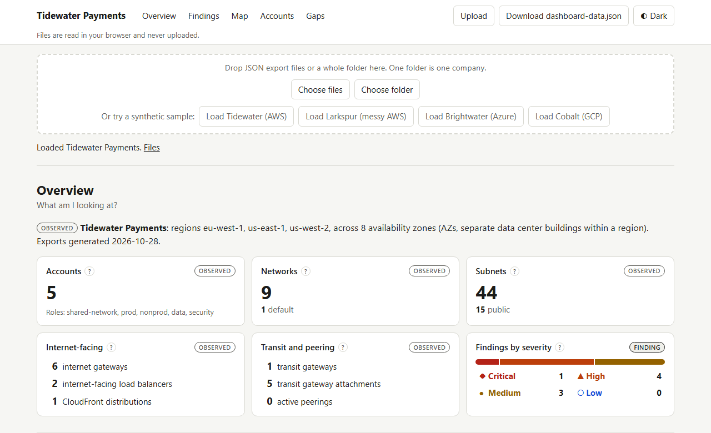
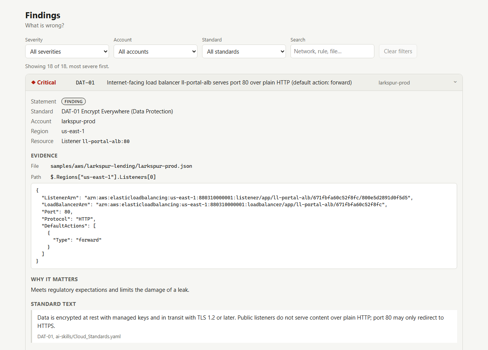
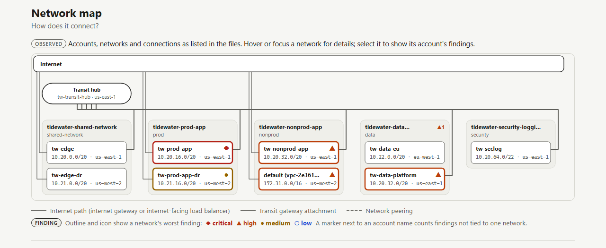
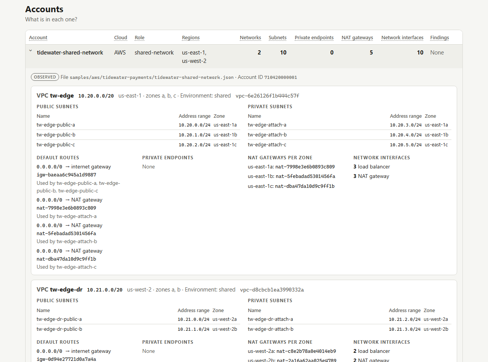
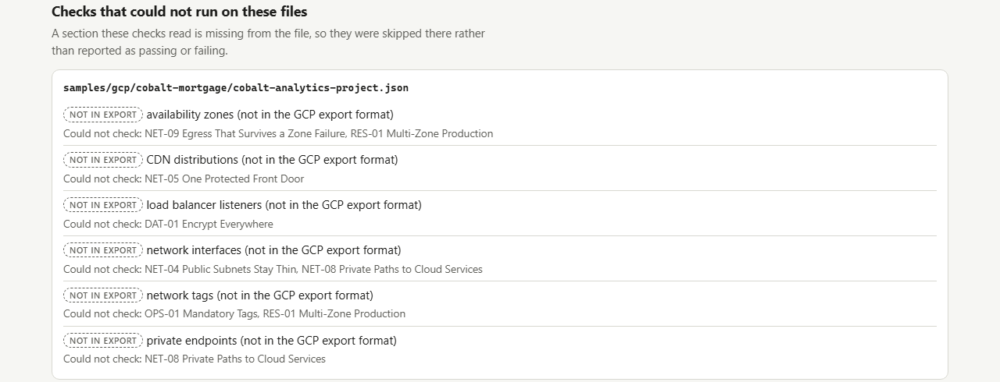

# Cloud Network Dashboard

Drop in a cloud inventory export (AWS, Azure or GCP) and get a clean network dashboard: what is there, what breaks the standards, how it connects, and what the files cannot tell you.

It is a static site with no backend and no build step. Files are read in your browser and never uploaded.



> **Everything here is fictional.** Kestrel Ridge Financial, Tidewater Payments, Larkspur Lending, Brightwater Insurance and Cobalt Mortgage are made-up companies. All account IDs, names and addresses in `samples/` are synthetic, and public IP addresses come from documentation ranges. No real environment or real company's data is included.

## How it works

1. **Parsing happens in the browser.** Each file is detected by its `_export.schema` and normalized into one model (accounts, networks, subnets, gateways, endpoints, firewall rules, load balancers, peerings, flow logs). Every record keeps the file and JSON path it came from.
2. **Checks are driven by [`ai-skills/Cloud_Standards.yaml`](ai-skills/Cloud_Standards.yaml).** Each mandate's `check` id names a rule, and thresholds (approved regions, admin and database ports, required tags, minimum zones) come from its `config` block, not from code. Mandates marked `check: manual` cannot be proven from an export and are listed under Gaps instead.
3. **Each fact appears once.** The page is built from one `dashboard-data.json` object (you can download it). Company totals live in Overview, problems in Findings, connections in the Map, per-account detail in Accounts, and unprovable items in Gaps. A test renders all five sections and fails if any count shows up in two of them.
4. **Statements are labeled** *Observed* (read from the file), *Finding* (a check failed) or *Not in export* (the file cannot answer it). A missing section is never shown as zero. Color only ever means severity, and always comes with an icon and a word.

| | |
|---|---|
|  |  |
| Each finding expands to the file, JSON path, raw snippet and the standard's own text. | The map is laid out by code: accounts as boxes, networks inside, transit and peering lines, outlines by worst finding. |
|  |  |
| One row per account, expanding to subnets, default routes, endpoints, NAT per zone and interfaces. | Gaps lists the manual standards and every check that could not run, by file and section. |

More views: [Cobalt (GCP) overview](docs/screenshots/gcp-overview.png), [manual standards](docs/screenshots/gaps-manual.png), [dark theme](docs/screenshots/dark.png), [phone](docs/screenshots/mobile.png).

## Supported formats

| Schema (`_export.schema`) | One file is | Sample |
|---|---|---|
| `aws-account-inventory/1.0` | one AWS account (shapes follow `aws ec2/elbv2/wafv2 describe-*`) | `samples/aws/tidewater-payments/`, `samples/aws/larkspur-lending/` |
| `azure-subscription-inventory/1.0` | one Azure subscription (shapes follow `az network ... list`) | `samples/azure/brightwater-insurance/` |
| `gcp-project-inventory/1.0` | one GCP project (shapes follow `gcloud compute ... list`) | `samples/gcp/cobalt-mortgage/` |

A folder of files is one company. [`samples/README.md`](samples/README.md) describes each format and what every check looks for. A file with an unknown schema, or that is not JSON, is reported by name and the rest still load.

## Run it locally

You need Python 3 (only for its built-in web server) and a modern browser. Browsers do not run ES modules from `file://`, so serve the folder:

```
python -m http.server 8000
```

Open http://localhost:8000/ and pick files or a folder, drop them on the page, or use a sample button. On some systems the command is `python3`.

After the page has loaded, uploading and analyzing your own files works offline.

## Run the tests

```
python tests/run_tests.py
python tests/run_tests.py --subfolder
```

The runner serves the repo, opens `tests/test.html` in headless Chrome or Edge, prints every result and exits non-zero on any failure. Set `BROWSER=/path/to/chrome` if it cannot find one. `--subfolder` serves the parent folder and opens the site from `/<repo folder>/`, as GitHub Pages does.

What the tests cover:
- the answer key in [`samples/EXPECTED_FINDINGS.md`](samples/EXPECTED_FINDINGS.md): every row for all four sample companies is reported and nothing else;
- every evidence path resolves in its file;
- thresholds follow `config`;
- "not in export" handling, using deliberately broken copies in `tests/fixtures/broken/` (regenerate with `python tests/make_broken_fixtures.py`);
- each section's rendering, and the map layout geometry (no overlaps or crossings, including a synthetic 13-account map);
- the one-home-per-count rule;
- color contrast in both themes;
- a keyboard walk of the whole page;
- empty and error states;
- offline uploads.

Step 1's count check: open http://localhost:8000/dev/counts.html and compare its per-account table with the one printed by `python tools/generate_samples.py`.

## Project structure

```
index.html                 the dashboard (Overview, Findings, Map, Accounts, Gaps)
css/app.css                styles: light and dark themes, phone layout, print stylesheet
js/
  app.js                   page controller: load files -> model -> checks -> dashboard-data -> render
  samples.js               sample sets for the "Load ..." buttons
  standards.js             reads Cloud_Standards.yaml
  dashboard-data.js        builds dashboard-data.json (with accounts-, map- and gaps-data.js)
  model/                   detect.js, aws.js, azure.js, gcp.js normalizers; model.js; counts.js;
                           concepts.js (shared vocabulary); jsonpath.js (evidence snippets)
  checks/                  checks.js (one function per check id), engine.js
  ui/                      one renderer per section, plus theme, upload and DOM helpers
  map-layout.js            map layout as a pure function
  vendor/js-yaml.mjs       YAML parser (MIT), vendored so the site works offline
ai-skills/                 Cloud_Standards.yaml and the team conventions it serves
samples/                   synthetic exports and the answer key
tools/generate_samples.py  regenerates the samples and the answer key (fixed seed)
tests/                     test page, runner and broken fixtures
dev/counts.html            per-account count check from build step 1
docs/                      design spec and screenshots
```

## Limitations

**What the exports do not contain.** These items show as *Not in export*, and the checks that need them are listed under Gaps rather than reported as passing or failing.

| | Azure | GCP |
|---|---|---|
| Route tables, so public vs private subnets | not in export | not in export |
| Internet gateways (so no internet edge on the map) | not in export | not in export |
| Network interfaces (NET-04, NET-08) | not in export | not in export |
| Load balancer listeners (DAT-01) | not in export | not in export (forwarding rules are not linked to backend services) |
| Availability zones (NET-09, RES-01) | not in export | not in export |
| Transit hubs and attachments | not in export | not in export |
| CDN distributions (the CDN part of NET-05) | not in export | not in export |
| Private endpoints | in the export | not in export (NET-08) |
| Labels on networks (OPS-01, RES-01) | VNet tags are in the export | not in export (GCP networks carry no labels) |

**Assumptions made for Azure and GCP:**
- A GCP network with no `peerings` field is treated as having no peerings, because gcloud leaves the field out when the list is empty.
- An Azure flow log counts only when it targets a VNet. Flow logs on network security groups are not counted toward a VNet.

**Other limits:**
- Azure NSG rules are checked as individual Allow rules. Rule priority and Deny rules that might override them are not evaluated, and Azure's built-in default rules are not in the export.
- An Azure application gateway or GCP backend service is not tied to a network in these exports, so it is counted and checked but not drawn on the map.
- Address-overlap (NET-03) compares IPv4 ranges of every network in a company, whether or not they are connected.
- Azure and GCP files have no company field, so their company is named after the folder.
- One company is shown at a time (pick another from the header).
- Thresholds and standards come only from `Cloud_Standards.yaml`. Changing a value there changes the result.

**Real data:** put real exports in `private-data/`, which is git-ignored. Never commit them or upload them to a public site.

## Credits

The YAML parser is [js-yaml](https://github.com/nodeca/js-yaml) 4.1.0 (MIT), vendored in `js/vendor/` with its license.
